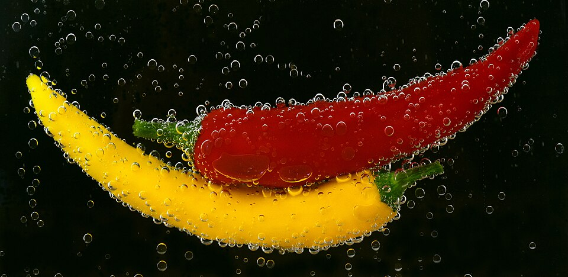
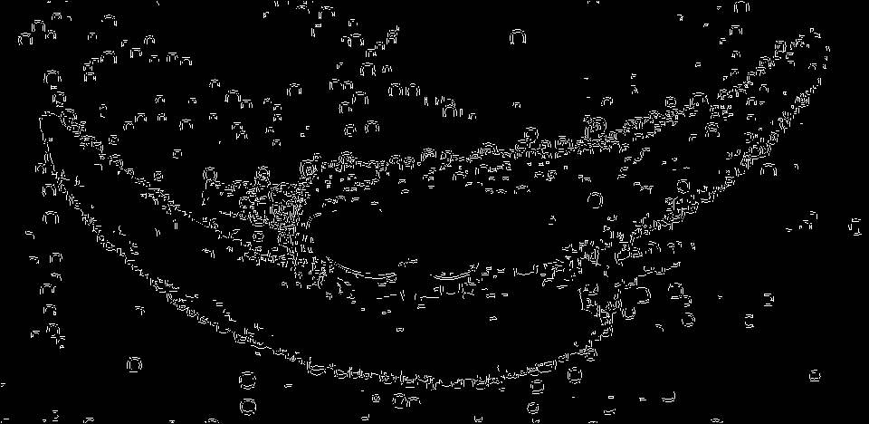
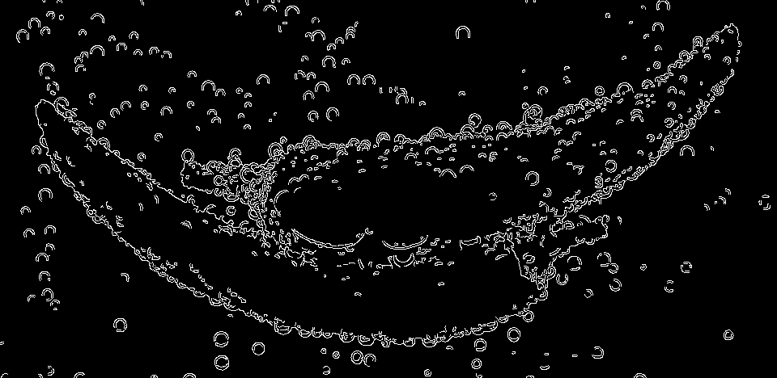

# Custom Canny Edge Detector

A learning project implementing the Canny edge detection pipeline in C++ using OpenCV.

The goal of this project is to understand the individual stages of edge detection by implementing them manually rather than relying entirely on OpenCV's built-in `cv::Canny()` function.

## Results

Both implementations process the same input image. Their outputs are shown side by side for visual comparison.

| Original Image | Custom Canny | OpenCV Canny |
|:---:|:---:|:---:|
|  |  |  |

## Features

The implementation includes the following stages:

1. **Grayscale conversion** — converts the input image to grayscale.
2. **Gaussian blur** — reduces image noise before edge detection.
3. **Sobel operators** — calculates horizontal and vertical image gradients.
4. **Gradient magnitude** — estimates the strength of intensity changes.
5. **Non-Maximum Suppression (NMS)** — thins detected edges by retaining local gradient maxima.
6. **Double thresholding** — classifies candidate edges as rejected, weak, or strong.
7. **Edge tracking by hysteresis** — retains weak edges connected to strong edges using 8-connectivity.

Intermediate images are saved to visualize the output of each stage.

## Technologies

- C++
- OpenCV
- CMake
- Visual Studio Code

## Project Structure

```text
02-custom-canny/
├── images/
│   ├── input.png
│   ├── 01_grayscale.png
│   ├── 02_gaussian_blur.png
│   ├── 03_gradient_magnitude.png
│   ├── 04_nms.png
│   ├── 05_double_threshold.png
│   ├── 06_my_own_canny.png
│   └── 07_canny_opencv.png
├── .gitignore
├── CMakeLists.txt
├── main.cpp
└── README.md
```

## Output

The program saves intermediate results, making it possible to inspect how the image changes throughout the pipeline.

| File | Description |
|---|---|
| `01_grayscale.png` | Grayscale input image |
| `02_gaussian_blur.png` | Image after Gaussian smoothing |
| `03_gradient_magnitude.png` | Gradient magnitude visualization |
| `04_nms.png` | Result of non-maximum suppression |
| `05_double_threshold.png` | Edge candidates after thresholding |
| `06_my_own_canny.png` | Final output of the custom implementation |
| `07_canny_opencv.png` | Reference output produced by OpenCV |

## Comparison with OpenCV

The project also runs OpenCV's built-in `cv::Canny()` implementation for reference.

The outputs are not expected to be pixel-identical. Differences can result from implementation details, gradient calculations, non-maximum suppression, and threshold handling.

The built-in implementation is used as a comparison point, not as a strict target for reproducing every pixel.

## Learning Objectives

This project explores:

- Image gradients and edge detection
- Convolution-based image processing
- Thresholding and 8-connected neighborhood traversal
- Intermediate visualization and debugging
- Implementing an image processing algorithm step by step

## Status

Completed as an educational implementation. Further improvements may include more precise gradient-direction handling, configurable thresholds, and additional test images.

## License

This project is intended for educational purposes.

The input image is sourced from [Wikimedia Commons](https://commons.wikimedia.org/wiki/File:Peppers_in_water.jpg). See the original file page for licensing details.